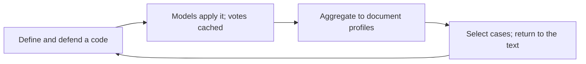

# Interpretive codes at scale: an LLM-in-the-loop workflow

This repository accompanies the proposal *"LLM-in-the-loop interpretive coding"*,
submitted for anonymous review. It implements the rules of the workflow the
proposal describes:

1. Human coders define and defend interpretive codes.
2. A panel of language models applies them to a corpus.
3. Passage-level votes are aggregated into document profiles that form a map of the
   corpus.
4. The map selects cases for close reading.
5. The return to the text is recorded without overwriting what came before.

The central question is how researchers can extend a collectively developed
interpretation across a large corpus while keeping the ability to explain,
challenge and revise it.



The repository is a reference implementation of the workflow's rules, not a model
pipeline. Model votes are cached, so it needs no API key, account or paid call.
Python 3.11 or later and the standard library are the only requirements.

## Two runs, about a minute in total

**1. Teaching example (synthetic).** This run uses invented texts and authored
model caches, so you can see every step:

- a code is refined during calibration;
- the models make a shared error;
- a contextual reading changes a proposed comparison case.

```sh
python3 -m interpretive_map --output outputs/example
```

Open `outputs/example/review.html`. [docs/WALKTHROUGH.md](docs/WALKTHROUGH.md)
explains what to notice in each output.

**2. Real-data replay (the empirical study).** This run recomputes the proposal's
proof of concept from frozen extracts of the study's records in `data/empirical/`.
It covers 830 campaigns, 16 adjudicated decisions and the 5 cases compared in
close reading.

```sh
python3 scripts/build_empirical_arc.py --output outputs/replay
```

Open `outputs/replay/index.html`. [docs/REAL_DATA_REPLAY.md](docs/REAL_DATA_REPLAY.md)
describes the inputs and the limits of what the replay establishes.

Each run writes to a new directory and refuses to overwrite an earlier one.
Repeated runs produce byte-identical files.

## What the implementation does

| Workflow step | What the code does | Where |
|---|---|---|
| Keep kinds of judgment apart | Classifies every segment–code judgment as single-coder, unanimous-individual, collective, adjudicated, unresolved or excluded. Only collective and adjudicated decisions count as references. | [judgments.py](interpretive_map/judgments.py) |
| Make model readings traceable | Ties each cached response to its passage, context, prompt version and hash. | [prompts.py](interpretive_map/prompts.py), [voting.py](interpretive_map/voting.py) |
| Apply named vote rules | Strict majority, unanimity with abstention, any-positive and all-positive. Abstentions and malformed responses count as neither yes nor no. | [voting.py](interpretive_map/voting.py), [METHOD.md](docs/METHOD.md) |
| Aggregate to documents | Builds document profiles with lower and upper bounds for unresolved segments, plus leave-one-model-out sensitivity. | [profiles.py](interpretive_map/profiles.py) |
| Score models against defended references | Exports true and false positives and negatives with coverage, so no score travels without its denominator. | [diagnostics.py](interpretive_map/diagnostics.py) |
| Flag documents for reading | Flags documents by vote-rule sensitivity, unresolved share and provisional-exemplar status. | [profiles.py](interpretive_map/profiles.py) |
| Record the return to the text | Stores corrections as dated overlays. Cached votes, codebook version and hold-out diagnostics stay unchanged. | `apply_corrections()` in [profiles.py](interpretive_map/profiles.py) |

[docs/ARCHITECTURE.md](docs/ARCHITECTURE.md) maps every file to its role.
[docs/SCHEMAS.md](docs/SCHEMAS.md) defines the output fields.

## What is included, and what is not

- **Included:**
  - the workflow code;
  - two versions of a teaching codebook;
  - the synthetic fixture;
  - frozen real-data extracts: campaign-level trope profiles and narrative
    measures for 830 campaigns, stored cluster assignments, comparison-matrix
    rows, five case cards, a correction overlay, and original, adjudicated and
    cached model labels for 16 selected passages.
- **Not included:**
  - report text (passages appear only as SHA-256 hashes and lengths);
  - coder identities;
  - the research database;
  - raw provider responses;
  - the production coding interface;
  - inference clients;
  - market data.

  The case cards are close readings supplied as evidence. The program presents
  them; it does not derive them.

## Checks

```sh
python3 -m unittest discover -s tests -v
python3 scripts/audit_artifact.py
```

26 tests check the contracts, including:

- reference-state distinctions;
- vote semantics and missingness;
- frozen calibration and hold-out splits;
- rejection of duplicate coding keys and changed inputs;
- refusal to overwrite prior outputs;
- an end-to-end, byte-identical replay of the real extracts.

The audit checks the file inventory against `allowlist.txt` and looks for common
accidental disclosures. [docs/VERIFICATION.md](docs/VERIFICATION.md) records what
was verified for this copy.

## Licence

This copy is shared for peer review only; see [LICENSE](LICENSE).
